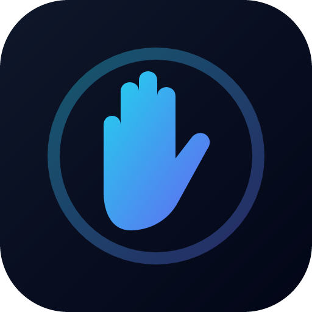

<p align="center">
  
</p>

<h1 align="center">Trace — AI Hand Companion</h1>

<p align="center">
  <strong>Ultra-responsive, offline-first interactive computer vision desktop & browser suite.</strong><br>
  Powered by <strong>Tauri v2</strong>, <strong>Rust + WebAssembly</strong>, <strong>MediaPipe Tasks Vision</strong>, and <strong>React 19</strong>.
</p>

<p align="center">
  
  
  
  
  
  
  
</p>

---

## ⚡ Overview

**Trace** is a high-performance, offline-capable AI hand companion that turns any standard webcam into a real-time, zero-latency gestural controller and gaming platform. All computer vision inference and geometric processing run 100% locally on your machine—no cloud APIs, no video streams leaving your device, and zero telemetry tracking.

### ✨ Key Capabilities

* 🎮 **RPS Arena (Rock-Paper-Scissors):**
  * 3-2-1 animated showdown against an interactive AI hand opponent.
  * **Cryptographic Fairness:** Employs a SHA-256 commit-reveal protocol with HMAC secret salts—guaranteeing the AI commits to its move before you show yours (provably impossible for the AI to cheat).
  * Real-time streak counters, win-rate analytics, and round history.

* 🥢 **Split (Chopsticks):**
  * Tactile two-handed strategy game against an intelligent AI opponent.
  * Physical touch collision detection: reach up with your fingers to physically tap the AI's virtual hands.
  * Rules engine supports exact-5 elimination, modulo rollover, and palm-clap split redistributions. Requires both user hands to be visible with valid counts before taps are permitted.

* 🏏 **Hand Cricket:**
  * Classic batsman vs. bowler finger showdown with 0–6 finger detection.
  * Interactive Odd/Even toss, fair AI randomized bowling/batting, target chasing, and over tracking.

* 🎨 **Air Canvas (Mid-Air Vector Drawing):**
  * Draw in mid-air using your index fingertip with pinch/release tactile drawing triggers.
  * **Adaptive 1-Euro Filter:** Eliminates webcam landmark jitter when holding still while maintaining zero lag during fast motion.
  * **Catmull-Rom Splines & Ramer-Douglas-Peucker:** Smooths hand-drawn paths into crisp vector strokes.
  * Export creations directly to **SVG** or **PNG**.

* 🏎️ **Universal Hardware Acceleration (NVIDIA, AMD, Intel, Apple, Qualcomm):**
  * Automatically detects and utilizes whatever graphics hardware is installed (NVIDIA RTX/GTX, AMD Radeon, Intel Arc/Iris, Apple M-Series, Qualcomm Snapdragon Adreno).
  * **Hot-Switching:** Seamlessly toggle between Hardware GPU and multithreaded CPU (WASM SIMD) with zero app restarts.
  * **Autonomous Watchdog & Power Recovery:** Automatically detects and mitigates driver down-throttling (such as NVIDIA Optimus P8 idle drops) and recycles Direct3D 11 staging textures every 500 frames to guarantee rock-solid 60 FPS.

---

## 🏗️ Architecture

```
                                  ┌────────────────────────┐
                                  │   Standard HD Webcam   │
                                  └───────────┬────────────┘
                                              │ Video Frames
                                              ▼
┌─────────────────────────────────────────────────────────────────────────────────┐
│ Web Worker (vision.worker.ts)                                                   │
│                                                                                 │
│   ┌────────────────────────────────┐         ┌──────────────────────────────┐   │
│   │ MediaPipe Tasks Vision         │         │ crates/trace-wasm            │   │
│   │ 21 3D Hand Landmarks (GPU/CPU) ├────────►│ Rust 1-Euro Filter           │   │
│   └────────────────────────────────┘         │ 3D Bone Angle Finger State   │   │
│                                              │ Temporal Gesture Stabilizer  │   │
│                                              └──────────────┬───────────────┘   │
└─────────────────────────────────────────────────────────────┼───────────────────┘
                                                              │ 60 FPS Event Bus
                                                              ▼
┌─────────────────────────────────────────────────────────────────────────────────┐
│ React 19 Frontend + Tailwind CSS v4                                             │
│                                                                                 │
│   [ RPS Arena ]      [ Split (Chopsticks) ]      [ Hand Cricket ]      [ Air Canvas ]
└─────────────────────────────────────────────────────────────────────────────────┘
                                       ▲
                                       │ Tauri IPC
                                       ▼
┌─────────────────────────────────────────────────────────────────────────────────┐
│ Tauri v2 Desktop Shell (Rust)                                                   │
│                                                                                 │
│   • Embedded SQLite (rusqlite) Persistence   • Dynamic Hardware Detection (CIM) │
│   • Native PNG / SVG File Exporters          • Global Shortcut (Ctrl+Shift+T)   │
│   • Process RSS Memory Telemetry             • Windows NSIS / Portable Bundler  │
└─────────────────────────────────────────────────────────────────────────────────┘
```

* **`crates/trace-core`**: Core Rust crate containing 3D vector geometry, bone-angle trigonometry, 1-Euro filter algorithms, stroke curve smoothing, and SHA-256 cryptographic commitment proofs.
* **`crates/trace-wasm`**: WebAssembly bindings using `wasm-bindgen` and `wasm-opt`, packaged directly for the browser and Web Worker.
* **`src/vision/`**: Dedicated Web Worker pipeline hosting MediaPipe and trace-wasm off the main UI thread.
* **`src-tauri`**: Native desktop shell with hardware management, SQLite profile persistence, and system telemetry.
* **`src/`**: Modern React 19 interface styled with an Obsidian Dark/Light palette.

---

## 🚀 Quick Start

### Prerequisites
* [Node.js](https://nodejs.org/) (v18 or higher) & `npm`
* [Rust](https://rustup.rs/) (v1.80+) with `wasm32-unknown-unknown` target:
  ```bash
  rustup target add wasm32-unknown-unknown
  ```
* [wasm-pack](https://rustwasm.github.io/wasm-pack/installer/):
  ```bash
  cargo install wasm-pack
  ```

### Development Setup

1. **Clone the repository:**
   ```bash
   git clone https://github.com/your-username/trace.git
   cd trace
   ```

2. **Install frontend dependencies:**
   ```bash
   npm install
   ```

3. **Fetch offline AI model weights (~7.8 MB):**
   ```bash
   npm run fetch:assets
   ```

4. **Compile the Rust WebAssembly pipeline:**
   ```bash
   npm run build:wasm
   ```

5. **Start the Tauri desktop application in development mode:**
   ```bash
   npm run tauri dev
   ```

---

## 🧪 Testing

Run both the Rust workspace test suite and the frontend unit test suite:

```bash
# Run Rust core tests
cargo test --workspace

# Run TypeScript & React unit tests (Vitest)
npm test
```

---

## 📦 Building for Production

To produce an optimized desktop installer and standalone portable `.exe`:

```bash
# Build production bundle
npm run tauri build
```

The compiled binaries will be output to:
* **Standalone Executable:** `Trace.exe`
* **Windows NSIS Installer:** `Trace_0.1.0_x64-setup.exe`

> **Windows Build Tip:** If your Windows user folder contains spaces, set `CARGO_TARGET_DIR=C:\Temp\trace-target` before invoking `tauri build` so MinGW/Windows resource compilers receive clean paths.

---

## ⚙️ Configuration & Hardware Options

Inside **Trace -> Settings**, you can configure:
* **Hardware Acceleration:** Toggle between auto-detected dedicated GPU (NVIDIA, AMD, Intel Arc, etc.) and multithreaded CPU WASM SIMD.
* **Frame Rate Cap:** Select between `15 FPS` (Battery Saver), `30 FPS` (Balanced), or `60 FPS` (Ultra Fluidity).
* **Camera Layout:** Switch between `Cover` (edge-to-edge fill) and `Contain` (full letterboxed aspect ratio).
* **Camera Hardware:** Switch active webcam devices, flip front/rear facing modes, and toggle mirrored preview.
* **Gesture Sensitivity:** Adjust the 1-Euro filter $f_c$ minimum cutoff frequency and speed coefficient $\beta$ for custom smoothing response.

---

## 📄 License

This project is licensed under the MIT License — see the [LICENSE](LICENSE) file for details.
